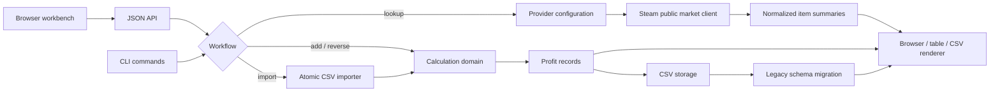

# Steam Profit Calculator

[](https://github.com/NoireOffical/steam-profit-calculator/actions/workflows/ci.yml)

[简体中文](README.zh-CN.md) | English

Steam Profit Calculator is a Go application for evaluating Steam Community Market trade scenarios. It provides both a browser workbench and a CLI for looking up market items, calculating profit across one or more sell prices, solving prices from targets, importing CSV scenarios, and persisting normalized results on the server.

The project keeps its formulas, storage schema, provider behavior, and error handling explicit. It is intended as a small, testable example of domain modeling, CLI design, external API integration, and backward-compatible CSV persistence.

> This project is not affiliated with Valve or Steam. Market data and calculated results are informational estimates, not financial advice.

## What it demonstrates

- A same-origin browser workbench and versioned JSON API
- Five compatible CLI commands: `lookup`, `add`, `reverse`, `import`, and `list`
- Forward calculations for multiple sell prices in one invocation
- Reverse calculations from target per-item profit, total profit, or knife ratio
- Configurable quantity and net multiplier, with a default multiplier of `0.837`
- Steam Community Market public lookup with timeouts, rate-limit retries, and normalized output
- Human-readable tables and machine-readable CSV output
- Atomic CSV imports: invalid input never produces partial persisted results
- Backward-compatible loading of legacy record schemas
- Deterministic price, ratio, and multiplier formatting
- Unit and integration tests across calculation, lookup, import, display, storage, and CLI layers
- Linux and macOS CI with formatting, `go vet`, race detection, and release builds

## Architecture



## Requirements

- Go 1.21 or newer
- Network access only when using `lookup`

The calculator, reverse solver, importer, storage, and list workflows run entirely locally and use only the Go standard library.

## Quick start

Run directly from the repository:

```bash
go run ./cmd/steam-profit add \
  --name "Capsule" \
  --buy 0.48 \
  --quantity 5 \
  --sell 0.70 \
  --sell 0.80
```

Build a reusable binary:

```bash
make build
./.build/steam-profit list
```

Run the complete local quality gate:

```bash
make check
```

## Browser workbench

Start the local web application:

```bash
make run-web
```

Open `http://127.0.0.1:8080`. The page can search for items, submit multiple sell-price scenarios, display server-calculated results, and refresh persisted history. All formulas remain in the Go domain layer and are not duplicated in browser code.

The server can also run from the embedded single binary:

```bash
make build
./.build/steam-profit-server --addr 127.0.0.1:8080 --file ./steam-profit-records.csv
```

Initial API routes:

| Method and path | Purpose |
| --- | --- |
| `GET /api/health` | Health check |
| `GET /api/v1/items` | Search normalized market items |
| `POST /api/v1/calculations` | Calculate and persist forward scenarios |
| `POST /api/v1/reverse-calculations` | Solve and persist a target price |
| `GET /api/v1/records` | Read server-side history |

This first web milestone is a local, single-user application and still uses CSV persistence. A database, authentication, rate limiting, and AI evaluation are required before public deployment.

## Commands

| Command | Purpose | Writes records |
| --- | --- | --- |
| `lookup` | Search item identifiers and current market summary fields | No |
| `add` | Calculate one or more forward profit scenarios | Yes |
| `reverse` | Solve a buy or sell price from one target metric | Yes |
| `import` | Validate and calculate a CSV batch atomically | Yes |
| `list` | Display persisted records | No |

### Look up market items

```bash
go run ./cmd/steam-profit lookup \
  --query "AK-47" \
  --limit 5
```

The default provider is Steam Community Market's public search endpoint for app ID `730`. Lookup output is a live snapshot and is not written to the profit-record file.

### Calculate profit

```bash
go run ./cmd/steam-profit add \
  --name "Capsule" \
  --buy 0.48 \
  --quantity 5 \
  --multiplier 0.85 \
  --sell 0.70 \
  --sell 0.80
```

Repeat `--sell` to calculate several exit prices. Each result is displayed and appended to the selected record file.

### Solve a target

Solve the sell price required for a target total profit:

```bash
go run ./cmd/steam-profit reverse \
  --name "Capsule" \
  --solve sell \
  --buy 0.48 \
  --quantity 5 \
  --target-total-profit 1.00
```

Solve the buy price for a target knife ratio:

```bash
go run ./cmd/steam-profit reverse \
  --name "Capsule" \
  --solve buy \
  --sell 0.80 \
  --target-knife-ratio 0.70
```

Exactly one of `--target-net-profit`, `--target-total-profit`, or `--target-knife-ratio` must be supplied.

### Import a batch

The input file must use this schema:

```csv
item_name,buy_price,sell_price,quantity,multiplier
Capsule,0.48,0.70,5,
Capsule,0.48,0.80,5,0.85
```

Import and render the results as CSV:

```bash
go run ./cmd/steam-profit import --input ./inputs.csv --output csv
```

The complete file is validated before any result is persisted.

### List stored records

```bash
go run ./cmd/steam-profit list
go run ./cmd/steam-profit list --output csv --file ./custom-records.csv
```

The default record file is `steam-profit-records.csv`. It is intentionally ignored by Git because it contains local runtime data.

## Calculation model

For buy price `B`, sell price `S`, quantity `Q`, and net multiplier `M`:

```text
net_profit   = S × M - B
total_profit = net_profit × Q
knife_ratio  = B / (S × M)
```

Defaults:

- quantity: `1`
- multiplier: `0.837`

Prices are stored with three decimal places, ratios with six, and explicitly supplied multipliers with three.

## Lookup configuration

Lookup behavior can be changed through environment variables:

| Variable | Default | Purpose |
| --- | --- | --- |
| `STEAM_PROFIT_LOOKUP_PROVIDER` | `steam_public` | Lookup implementation |
| `STEAM_PROFIT_LOOKUP_BASE_URL` | `https://steamcommunity.com` | Provider base URL |
| `STEAM_PROFIT_LOOKUP_APP_ID` | `730` | Steam application ID |
| `STEAM_PROFIT_LOOKUP_TIMEOUT_MS` | `5000` | Request timeout |
| `STEAM_PROFIT_LOOKUP_API_KEY` | empty | Optional provider API key |
| `STEAM_PROFIT_LOOKUP_API_KEY_HEADER` | `X-API-Key` | API-key header |
| `STEAM_PROFIT_LOOKUP_USER_AGENT` | `steam-profit-calculator/lookup` | HTTP user agent |

Secrets should be supplied through the environment. Local `.env` files are ignored and must not be committed.

## Record schema

Terminal and `--output csv` rendering use seven fields:

```text
item_name,buy_price,sell_price,quantity,net_profit,total_profit,knife_ratio
```

Persisted records add a `fee` field that records whether the default or an explicit multiplier was used:

```text
item_name,buy_price,sell_price,quantity,net_profit,total_profit,knife_ratio,fee
```

Older five- and seven-column files remain readable and are migrated when new records are appended.

## Project structure

```text
cmd/steam-profit/        CLI entry point
cmd/steam-profit-server/ Web server entry point
internal/calculation/    Forward and reverse formulas
internal/cli/            Command parsing and orchestration
internal/display/        Table and CSV rendering
internal/domain/         Requests, records, and field schemas
internal/importer/       Atomic batch parsing
internal/lookup/         Provider configuration and HTTP client
internal/storage/        CSV persistence and schema compatibility
internal/webapi/         JSON API and embedded browser application
openspec/                Requirements and archived change history
```

## Development

```bash
make fmt
make vet
make test-race
make build
make run-web
```

Every push and pull request to `main` runs the same checks on Linux and macOS. Dependabot checks Go modules and GitHub Actions weekly.

For the complete command reference, field definitions, and error examples, see [CLI_USAGE.md](CLI_USAGE.md).

For the remaining AI, database, evaluation, and deployment scope, see the [AI full-stack roadmap and workload estimate](docs/AI_FULLSTACK_ROADMAP.zh-CN.md) (Chinese).

## License

Released under the [MIT License](LICENSE).
