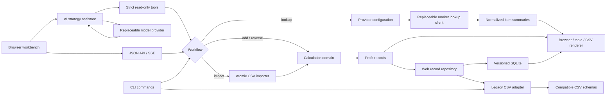

# Steam Profit Calculator

[](https://github.com/NoireOffical/steam-profit-calculator/actions/workflows/ci.yml)

[简体中文](README.zh-CN.md) | English

Steam Profit Calculator is a Go application for evaluating Steam Community Market trade scenarios. It provides an optional tool-grounded AI strategy assistant, a browser workbench, and a CLI for looking up market items, calculating profit across one or more sell prices, solving prices from targets, importing CSV scenarios, and persisting normalized results on the server.

The project keeps its formulas, storage schema, provider behavior, and error handling explicit. It is intended as a small, testable example of domain modeling, CLI design, external API integration, versioned SQLite persistence, and backward-compatible CSV migration.

> This project is not affiliated with Valve or Steam. Market data and calculated results are informational estimates, not financial advice.

## Plug-in external capabilities, not runtime prerequisites

Market data and AI are replaceable adapters rather than dependencies of deterministic calculation, SQLite history, or CSV workflows:

- **The website works without external API keys.** Profit calculation, target solving, record persistence, filtering, pagination, and import/export stay local. AI is disabled by default, while lookup defaults to the keyless `steam_public` adapter.
- **SteamApis is ready when configured.** After the server receives `STEAM_PROFIT_LOOKUP_PROVIDER=steamapis` and an API key, the browser, JSON API, CLI `lookup`, and AI `lookup_items` tool reuse the same normalized lookup boundary. Rotating the key or switching back to `steam_public` requires no UI, command, or data migration.
- **OpenAI is ready when configured.** Setting `STEAM_PROFIT_AI_PROVIDER=openai` and a server-side API key adds the natural-language assistant. Provider selection, base URL, model, and key remain environment-managed and independently replaceable. A missing or unavailable model disables only the assistant, not the rest of the site.
- **Several entry points reuse one trusted core.** Browser, JSON API, CLI, and AI tools can invoke lookup and calculation capabilities; providers supply external information, while monetary results still come from the deterministic engine.

Provider selection is explicit and never silently falls back. Configure a valid key before selecting `steamapis`; a runtime data-source outage fails lookup clearly while calculation, target solving, and history remain available.

## What it demonstrates

- A same-origin browser workbench and versioned JSON API
- An optional AI strategy assistant with strict read-only lookup, calculation, and reverse tools
- Typed Responses API streaming, SSE progress, structured evidence, and model-usage metadata
- A numeric grounding guard that suppresses uncited or unsupported model numbers
- Six-message page-local conversation context with explicit Stop and Retry controls
- A 50-case deterministic baseline plus a 12-case opt-in semantic evaluation suite and JSON reports
- Versioned SQLite web persistence with durable record IDs and UTC timestamps
- Server-side item/outcome filters, stable ordering, and bounded history pagination
- Explicit, idempotent CSV-to-SQLite import plus a legacy CSV rollback mode
- Seven isolated Playwright Chromium workflows covering persistence, pagination, validation, AI-disabled fallback, transient context/retry, cancellation, and demo access control
- A non-root Docker Compose demo with deterministic seed data, a named SQLite volume, and health checks
- Optional shared demo credentials, per-client API limiting, a global model-run quota, and read-only hosted synthetic checks
- A verified single-replica Railway deployment with managed HTTPS, persistent SQLite storage, restart checks, and a rehearsed manual export/restore path
- Request IDs, content-free structured request logs, and aggregate request/assistant metrics
- Five compatible CLI commands: `lookup`, `add`, `reverse`, `import`, and `list`
- Forward calculations for multiple sell prices in one invocation
- Reverse calculations from target per-item profit, total profit, or knife ratio
- Configurable quantity and net multiplier, with a default multiplier of `0.837`
- Steam Community Market public lookup and authenticated SteamApis v2 search with timeouts, rate-limit retries, and normalized output
- Human-readable tables and machine-readable CSV output
- Atomic CSV imports: invalid input never produces partial persisted results
- Backward-compatible loading of legacy record schemas
- Deterministic price, ratio, and multiplier formatting
- Unit and integration tests across calculation, lookup, import, display, storage, and CLI layers
- Linux and macOS CI with formatting, `go vet`, race detection, release builds, browser E2E, and container smoke tests

## Architecture



## Requirements

- Go 1.21 or newer
- Node.js and pnpm for browser-script checks and optional Playwright E2E
- Docker Engine or Docker Desktop only for the container demo
- Network access only when using `lookup`

The calculator, reverse solver, importer, storage, and list workflows run entirely locally. The web server uses the pinned CGo-free `modernc.org/sqlite` driver; deterministic CLI workflows keep their existing CSV behavior.

## Quick start

Run directly from the repository:

```bash
go run ./cmd/steam-profit add \
  --name "Capsule" \
  --buy 0.48 \
  --quantity 5 \
  --sell 0.70 \
  --sell 0.80
```

Build a reusable binary:

```bash
make build
./.build/steam-profit list
```

Run the complete local quality gate:

```bash
make check
```

Run the seeded three-to-five-minute demo:

```bash
make demo-run
```

Or launch the same single-process application with a durable Docker volume:

```bash
docker compose up --build --wait
```

See the [demo and operations runbook](docs/DEMO_RUNBOOK.zh-CN.md) for the walkthrough, browser test, backup, restore, and rollback paths. The [controlled hosted-demo runbook](docs/HOSTED_DEMO_RUNBOOK.zh-CN.md) defines the Railway HTTPS, secret, limit, persistent-volume, synthetic-check, and release boundary.

The controlled Railway demo is live at [steam-profit-calculator-production.up.railway.app](https://steam-profit-calculator-production.up.railway.app). The health endpoint is public; the workbench requires a separately supplied reviewer credential. The hosted assistant intentionally remains disabled until a temporary model key and paid evaluation budget are supplied.

## Browser workbench

Start the local web application:

```bash
make run-web
```

Open `http://127.0.0.1:8080`. The page can use the AI strategy assistant, search for items, submit multiple sell-price scenarios, display server-calculated results, and refresh persisted history. All formulas remain in the Go domain layer and are not duplicated by the browser or model.

The server can also run from the embedded single binary:

```bash
make build
./.build/steam-profit-server --addr 127.0.0.1:8080 --db ./steam-profit.db
```

Initial API routes:

| Method and path | Purpose |
| --- | --- |
| `GET /api/health` | Health check |
| `GET /api/v1/metrics` | Read content-free aggregate runtime metrics |
| `GET /api/v1/items` | Search normalized market items |
| `POST /api/v1/calculations` | Calculate and persist forward scenarios |
| `POST /api/v1/reverse-calculations` | Solve and persist a target price |
| `GET /api/v1/records` | Read filtered, paginated server-side history |
| `GET /api/v1/assistant/status` | Read safe assistant availability metadata |
| `POST /api/v1/assistant/stream` | Stream tool progress, evidence, and answer events over SSE |

`GET /api/v1/records` accepts `item`, `outcome=all|profit|loss`, `order=newest|oldest`, `limit=1..100`, and a non-negative `offset`. Stored records include a durable `id` and `created_at`; responses include `total`, `limit`, `offset`, and `has_more` pagination metadata.

SQLite is the default web persistence mode. Import a historical compatible CSV explicitly and safely repeat the command when the file grows:

```bash
./.build/steam-profit-server --db ./steam-profit.db --import-csv ./steam-profit-records.csv
```

The source CSV is never modified. Existing source rows are skipped on repeat imports. To roll the web server back to the previous storage behavior:

```bash
./.build/steam-profit-server --storage csv --file ./steam-profit-records.csv
```

| Variable | Default | Purpose |
| --- | --- | --- |
| `PORT` | empty | Hosting-platform port; binds `0.0.0.0:$PORT` when no explicit server address is set |
| `STEAM_PROFIT_STORAGE` | `sqlite` | Web repository: `sqlite` or `csv` |
| `STEAM_PROFIT_DATABASE_FILE` | `steam-profit.db` | SQLite database path |
| `STEAM_PROFIT_RECORD_FILE` | `steam-profit-records.csv` | CSV path used in legacy mode |
| `STEAM_PROFIT_IMPORT_CSV` | empty | Compatible CSV imported before SQLite startup |
| `STEAM_PROFIT_DEMO_USERNAME` | empty | Optional shared demo username; configure with the password |
| `STEAM_PROFIT_DEMO_PASSWORD` | empty | Optional shared demo password; at least 12 characters |
| `STEAM_PROFIT_RATE_LIMIT_PER_MINUTE` | `0` | Per-client API requests per minute; `0` disables |
| `STEAM_PROFIT_AI_RUNS_PER_HOUR` | `0` | Process-wide started model runs per hour; `0` disables |
| `STEAM_PROFIT_TRUST_PROXY_HEADERS` | `false` | Enable only when a trusted proxy supplies `X-Real-IP` or `X-Forwarded-For` |

Every HTTP response includes an `X-Request-ID`. Request logs contain method, path, status, duration, and request ID only; aggregate metrics omit query strings, bodies, prompts, model output, market data, credentials, and record values.

This remains a local single-user application or a controlled demo for a small reviewer group. The Railway instance has been verified with shared Basic credentials, public dependency health, request limits, one persistent SQLite volume, an application restart exercise, and a full-volume export that passed SQLite integrity and isolated-restore checks. It is not a full user system: registration, tenant isolation, cross-replica limits, persistent telemetry, managed backup/PITR, and a paid live-model baseline are still absent. The browser may send at most six page-local prior messages, but conversations, provider responses, and tool evidence are never persisted.

## AI strategy assistant

The assistant is a plug-in enhancement and is disabled by default, so missing model credentials never prevent the server, deterministic browser workbench, or CLI from running. Enable the OpenAI provider with environment variables:

```bash
export STEAM_PROFIT_AI_PROVIDER=openai
export STEAM_PROFIT_AI_API_KEY="your-api-key"
make run-web
```

The standard `OPENAI_API_KEY` is also accepted. Provider selection, base URL, key, model, and settings are environment-only and can be replaced or disabled later without migrating calculation records or changing deterministic tool contracts. Never commit a real key.

| Variable | Default | Purpose |
| --- | --- | --- |
| `STEAM_PROFIT_AI_PROVIDER` | `disabled` | `disabled` or `openai` |
| `STEAM_PROFIT_AI_BASE_URL` | `https://api.openai.com/v1` | Responses API base URL |
| `STEAM_PROFIT_AI_MODEL` | `gpt-5.6-terra` | Replaceable model name |
| `STEAM_PROFIT_AI_REASONING_EFFORT` | `low` | `none`, `low`, `medium`, `high`, `xhigh`, or `max` |
| `STEAM_PROFIT_AI_VERBOSITY` | `low` | `low`, `medium`, or `high` |
| `STEAM_PROFIT_AI_MAX_OUTPUT_TOKENS` | `1200` | Maximum output tokens per model turn |
| `STEAM_PROFIT_AI_TIMEOUT_MS` | `25000` | Per-model-request timeout |
| `STEAM_PROFIT_AI_API_KEY` | empty | API key, preferred over `OPENAI_API_KEY` |

The adapter follows OpenAI's official [Responses API function-calling](https://developers.openai.com/api/docs/guides/function-calling) and [typed streaming](https://developers.openai.com/api/docs/guides/streaming-responses) flows. `lookup_items`, `calculate_profit`, and `solve_target` are read-only. Every successful tool result gets a `T1`/`T2` evidence ID. Final prose must cite all applicable evidence and may contain only numbers present in current-turn tool output; otherwise the server substitutes a safe evidence-directed response.

SSE event names remain `status`, `tool_start`, `evidence`, `delta`, `done`, and `error`. The provider adapter parses native text and function-argument deltas, but the service buffers the complete answer until grounding passes. A valid answer is then released using the provider's original delta boundaries; invalid provider text is never exposed. The optional request `history` field accepts at most six `user` or `assistant` messages and remains transient.

### AI quality evaluation

Normal tests execute exactly 50 deterministic tool cases and scripted report tests without Steam or OpenAI network calls. Live semantic evaluation is always explicit and uses a deterministic lookup fixture:

```bash
export STEAM_PROFIT_AI_PROVIDER=openai
export STEAM_PROFIT_AI_API_KEY="temporary-key"
make ai-eval
make ai-eval-baseline
```

The current-prompt report is written to `.build/evaluations/report.json`; the retained baseline writes `.build/evaluations/baseline-report.json`. Reports contain case IDs, prompt/model versions, observed tools, grounding, latency, token usage, threshold failures, and optional cost estimates. They omit credentials, prompt text, model prose, and tool values. Cost is calculated only when the caller supplies rates such as `--input-usd-per-million` and `--output-usd-per-million`; the project does not hard-code provider prices.

The `Live AI Evaluation` GitHub workflow is manual-only and uses an injected repository secret for a bounded current/baseline comparison. Normal CI never calls a live model. Once a hosted URL is configured, `Hosted Demo Smoke` runs read-only checks every six hours without mutations or model calls. See the [controlled hosted-demo runbook](docs/HOSTED_DEMO_RUNBOOK.zh-CN.md) for setup.

## Commands

| Command | Purpose | Writes records |
| --- | --- | --- |
| `lookup` | Search item identifiers and current market summary fields | No |
| `add` | Calculate one or more forward profit scenarios | Yes |
| `reverse` | Solve a buy or sell price from one target metric | Yes |
| `import` | Validate and calculate a CSV batch atomically | Yes |
| `list` | Display persisted records | No |

### Look up market items

```bash
go run ./cmd/steam-profit lookup \
  --query "AK-47" \
  --limit 5
```

The default provider remains Steam Community Market's public search endpoint for app ID `730`. Selecting `steamapis` uses one direct SteamApis v2 keyword search without downloading a full catalog or requesting item details. Lookup output is a read-only snapshot and is not written to the profit-record file.

### Calculate profit

```bash
go run ./cmd/steam-profit add \
  --name "Capsule" \
  --buy 0.48 \
  --quantity 5 \
  --multiplier 0.85 \
  --sell 0.70 \
  --sell 0.80
```

Repeat `--sell` to calculate several exit prices. Each result is displayed and appended to the selected record file.

### Solve a target

Solve the sell price required for a target total profit:

```bash
go run ./cmd/steam-profit reverse \
  --name "Capsule" \
  --solve sell \
  --buy 0.48 \
  --quantity 5 \
  --target-total-profit 1.00
```

Solve the buy price for a target knife ratio:

```bash
go run ./cmd/steam-profit reverse \
  --name "Capsule" \
  --solve buy \
  --sell 0.80 \
  --target-knife-ratio 0.70
```

Exactly one of `--target-net-profit`, `--target-total-profit`, or `--target-knife-ratio` must be supplied.

### Import a batch

The input file must use this schema:

```csv
item_name,buy_price,sell_price,quantity,multiplier
Capsule,0.48,0.70,5,
Capsule,0.48,0.80,5,0.85
```

Import and render the results as CSV:

```bash
go run ./cmd/steam-profit import --input ./inputs.csv --output csv
```

The complete file is validated before any result is persisted.

### List stored records

```bash
go run ./cmd/steam-profit list
go run ./cmd/steam-profit list --output csv --file ./custom-records.csv
```

The default record file is `steam-profit-records.csv`. It is intentionally ignored by Git because it contains local runtime data.

## Calculation model

For buy price `B`, sell price `S`, quantity `Q`, and net multiplier `M`:

```text
net_profit   = S × M - B
total_profit = net_profit × Q
knife_ratio  = B / (S × M)
```

Defaults:

- quantity: `1`
- multiplier: `0.837`

Prices are stored with three decimal places, ratios with six, and explicitly supplied multipliers with three.

## Lookup configuration

Lookup behavior can be changed through environment variables:

The normalized lookup boundary is shared by browser search, `/api/v1/items`, CLI `lookup`, and the assistant's read-only `lookup_items` tool. Switching providers or rotating a key does not change those entry points or rewrite profit history; an unavailable data source affects lookup only.

| Variable | Default | Purpose |
| --- | --- | --- |
| `STEAM_PROFIT_LOOKUP_PROVIDER` | `steam_public` | Lookup implementation: `steam_public` or `steamapis` |
| `STEAM_PROFIT_LOOKUP_BASE_URL` | provider-specific | `https://steamcommunity.com` for `steam_public`; `https://marketplaceapi.steamapis.com` for `steamapis` |
| `STEAM_PROFIT_LOOKUP_APP_ID` | `730` | Steam application ID |
| `STEAM_PROFIT_LOOKUP_TIMEOUT_MS` | `5000` | Request timeout |
| `STEAM_PROFIT_LOOKUP_API_KEY` | empty | Server-side API key required by `steamapis` |
| `STEAM_PROFIT_LOOKUP_API_KEY_HEADER` | `X-API-Key` | API-key header |
| `STEAM_PROFIT_LOOKUP_USER_AGENT` | `steam-profit-calculator/lookup` | HTTP user agent |

Secrets should be supplied through the environment. Local `.env` files are ignored and must not be committed.

Use the direct SteamApis search path with:

```bash
export STEAM_PROFIT_LOOKUP_PROVIDER=steamapis
export STEAM_PROFIT_LOOKUP_API_KEY="your-steamapis-key"
go run ./cmd/steam-profit lookup --query "AK-47 Redline" --limit 5
```

SteamApis search results can come from third-party marketplaces such as Buff163 or Skinport. The compatible `sell_price_text` includes that source, for example `$45.99 (Buff163)`, while `sale_price_text` remains empty because the lightweight search response has no separate recent-sale value. Treat the result as a provider snapshot, not an official Steam quote.

## Record schema

Terminal and `--output csv` rendering use seven fields:

```text
item_name,buy_price,sell_price,quantity,net_profit,total_profit,knife_ratio
```

Persisted records add a `fee` field that records whether the default or an explicit multiplier was used:

```text
item_name,buy_price,sell_price,quantity,net_profit,total_profit,knife_ratio,fee
```

Older five- and seven-column files remain readable and are migrated when new records are appended.

The web SQLite schema stores the same canonical values as scaled integers, plus record identity, UTC creation time, source metadata, and nullable future ownership/session fields. Ordered migrations are recorded in `schema_migrations`; released migrations are immutable.

## Project structure

```text
cmd/steam-profit/        CLI entry point
cmd/steam-profit-server/ Web server entry point
cmd/steam-profit-eval/   Opt-in live semantic evaluation entry point
internal/calculation/    Forward and reverse formulas
internal/cli/            Command parsing and orchestration
internal/display/        Table and CSV rendering
internal/domain/         Requests, records, and field schemas
internal/importer/       Atomic batch parsing
internal/lookup/         Provider configuration and HTTP client
internal/assistant/      Model provider, read-only tools, grounding, and evaluations
internal/evaluation/     Versioned semantic suite and content-free reports
internal/observability/ Request correlation, safe logs, and aggregate metrics
internal/storage/        SQLite repository, CSV compatibility, and migration
internal/webapi/         JSON API and embedded browser application
demo/                    Deterministic idempotent seed dataset
tests/e2e/               Playwright browser workflows
openspec/                Requirements and archived change history
```

## Development

```bash
make fmt
make vet
make test-race
make build
make run-web
make e2e
make container-check
```

Every push and pull request to `main` runs deterministic checks on Linux and macOS plus Chromium E2E and a Compose persistence smoke test. Dependabot checks Go modules, JavaScript packages, container bases, and GitHub Actions weekly.

For the complete command reference, field definitions, and error examples, see [CLI_USAGE.md](CLI_USAGE.md).

For the remaining AI, database, evaluation, and deployment scope, see the [AI full-stack roadmap and workload estimate](docs/AI_FULLSTACK_ROADMAP.zh-CN.md) (Chinese).

Demonstrable milestones use immutable Semantic Version tags and GitHub Pre-releases. See the [release workflow](docs/development/release-workflow.md) and [changelog](CHANGELOG.md).

## License

Released under the [MIT License](LICENSE).
