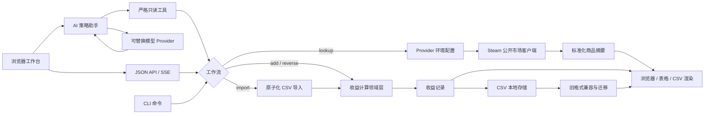

# Steam Profit Calculator：Steam 市场收益分析工作台

[](https://github.com/NoireOffical/steam-profit-calculator/actions/workflows/ci.yml)

简体中文 | [English](README.md)

Steam Profit Calculator 是一个使用 Go 编写的 Steam Community Market 收益分析应用。它同时提供带可信工具调用的 AI 策略助手、浏览器工作台和命令行工具，支持查询市场商品、按一个或多个卖价正向计算收益、根据目标收益或挂刀比例反推买卖价格、批量导入 CSV 场景，以及在服务端持久化和展示计算记录。

项目刻意保持计算公式、存储格式、外部 provider 行为和错误处理清晰可见，可作为领域建模、CLI 设计、外部 API 集成和兼容性数据迁移的小型工程示例。

> 本项目与 Valve 或 Steam 无关联。市场数据和计算结果仅供参考，不构成投资或交易建议。

## 核心能力

- 提供同源浏览器工作台和版本化 JSON API；
- 提供可选的 AI 策略助手，通过严格工具调用查询、计算和反推，不让模型自行计算；
- 通过 SSE 渐进展示工具进度、结构化依据、回答和模型用量；
- 对模型回答执行数值溯源校验，无引用或工具结果中不存在的数字会被安全替换；
- 提供 30 条无需真实模型密钥的固定评测基线；
- 保留 `lookup`、`add`、`reverse`、`import`、`list` 五个独立 CLI 命令；
- 一次传入多个卖价，批量计算不同退出价格下的收益；
- 根据目标单件收益、目标总收益或挂刀比例反推买价/卖价；
- 支持数量和净倍率配置，默认净倍率为 `0.837`；
- 对接 Steam Community Market 公开搜索接口，支持超时、限流重试和统一字段输出；
- 支持终端表格和 CSV 两种展示方式；
- 批量导入前先校验完整文件，错误输入不会造成部分落盘；
- 兼容旧版 CSV 记录格式，并在后续写入时迁移为当前格式；
- 对价格、倍率和挂刀比例执行确定性精度格式化；
- 覆盖计算、查询、导入、展示、存储和 CLI 编排层的自动测试；
- 使用 GitHub Actions 在 Linux/macOS 执行格式、静态检查、竞态测试和构建。

## 技术架构



## 环境要求

- Go 1.21 或更高版本；
- Node.js（仅用于 `make check` 的浏览器脚本语法检查）；
- 仅 `lookup` 命令需要网络访问。

正向计算、反向求解、导入、存储和记录读取完全在本地运行，项目当前只依赖 Go 标准库。

## 快速开始

在仓库根目录直接运行：

```bash
go run ./cmd/steam-profit add \
  --name "Capsule" \
  --buy 0.48 \
  --quantity 5 \
  --sell 0.70 \
  --sell 0.80
```

构建可重复使用的二进制：

```bash
make build
./.build/steam-profit list
```

运行与 CI 一致的完整本地检查：

```bash
make check
```

## 浏览器工作台

启动本地 Web 应用：

```bash
make run-web
```

然后打开 `http://127.0.0.1:8080`。页面可以使用 AI 策略助手、查询商品、提交多个卖价场景、查看服务端计算结果和刷新历史记录。所有公式仍由现有 Go 领域层执行，浏览器和模型都不会复制收益公式。

服务端也可以从已构建的单一二进制启动：

```bash
make build
./.build/steam-profit-server --addr 127.0.0.1:8080 --file ./steam-profit-records.csv
```

首个版本提供以下 API：

| 方法与路径 | 用途 |
| --- | --- |
| `GET /api/health` | 健康检查 |
| `GET /api/v1/items` | 查询标准化市场商品 |
| `POST /api/v1/calculations` | 计算并保存正向收益场景 |
| `POST /api/v1/reverse-calculations` | 反推并保存目标价格 |
| `GET /api/v1/records` | 读取服务端历史记录 |
| `GET /api/v1/assistant/status` | 读取不含密钥的助手可用状态 |
| `POST /api/v1/assistant/stream` | 以 SSE 返回工具进度、依据和回答 |

当前 Web 版本面向本地单用户实践，仍使用 CSV 存储。AI 对话是无状态且不落盘的；公开部署前仍需完成数据库、身份认证、限流、真实模型评测和运行监控。

## AI 策略助手

助手默认关闭，因此没有模型密钥时，服务器、浏览器确定性工作台和 CLI 都可以正常运行。要启用 OpenAI Provider：

```bash
export STEAM_PROFIT_AI_PROVIDER=openai
export STEAM_PROFIT_AI_API_KEY="your-api-key"
make run-web
```

也可以使用标准的 `OPENAI_API_KEY`。密钥、模型和所有配置都从环境读取，后续可以随时替换；不要把真实密钥写进 `.env.example` 或提交到 Git。

| 环境变量 | 默认值 | 用途 |
| --- | --- | --- |
| `STEAM_PROFIT_AI_PROVIDER` | `disabled` | `disabled` 或 `openai` |
| `STEAM_PROFIT_AI_BASE_URL` | `https://api.openai.com/v1` | Responses API 基础地址 |
| `STEAM_PROFIT_AI_MODEL` | `gpt-5.6-terra` | 可替换模型名称 |
| `STEAM_PROFIT_AI_REASONING_EFFORT` | `low` | `none` / `low` / `medium` / `high` / `xhigh` / `max` |
| `STEAM_PROFIT_AI_VERBOSITY` | `low` | `low` / `medium` / `high` |
| `STEAM_PROFIT_AI_MAX_OUTPUT_TOKENS` | `1200` | 单次模型回答的最大输出 Token |
| `STEAM_PROFIT_AI_TIMEOUT_MS` | `25000` | 单次模型请求超时 |
| `STEAM_PROFIT_AI_API_KEY` | 空 | OpenAI API 密钥，优先于 `OPENAI_API_KEY` |

实现遵循 OpenAI 官方的 [Responses API 函数调用流程](https://developers.openai.com/api/docs/guides/function-calling)；三个工具是只读的：

- `lookup_items`：读取带查询时间的市场快照；
- `calculate_profit`：调用确定性正向计算，不保存记录；
- `solve_target`：调用确定性反推，不保存记录。

每个成功工具结果都会生成 `T1`、`T2` 形式的依据编号。最终模型文本必须引用相关编号，且其中每个数字都必须存在于工具输出，否则服务端会用安全说明替换模型原文。SSE 事件包括 `status`、`tool_start`、`evidence`、`delta`、`done` 和 `error`。当前 `delta` 是服务端对完整模型回答的分块输出，后续可在不改变浏览器契约的情况下升级为 Provider 原生 token 流。

## 命令总览

| 命令 | 用途 | 写入记录 |
| --- | --- | --- |
| `lookup` | 查询商品标识和实时市场摘要字段 | 否 |
| `add` | 正向计算一个或多个卖价场景 | 是 |
| `reverse` | 根据单一目标指标反推买价或卖价 | 是 |
| `import` | 原子化校验并导入 CSV 批量场景 | 是 |
| `list` | 展示已经保存的记录 | 否 |

### 查询市场商品

```bash
go run ./cmd/steam-profit lookup \
  --query "AK-47" \
  --limit 5
```

默认 provider 为 Steam Community Market 的公开搜索接口，默认应用 ID 为 `730`。查询结果是实时快照，不会写入收益记录文件。

### 正向计算收益

```bash
go run ./cmd/steam-profit add \
  --name "Capsule" \
  --buy 0.48 \
  --quantity 5 \
  --multiplier 0.85 \
  --sell 0.70 \
  --sell 0.80
```

重复传入 `--sell` 可以计算多个卖价。每条结果都会展示并追加到指定记录文件。

### 根据目标反推

根据目标总收益反推卖价：

```bash
go run ./cmd/steam-profit reverse \
  --name "Capsule" \
  --solve sell \
  --buy 0.48 \
  --quantity 5 \
  --target-total-profit 1.00
```

根据目标挂刀比例反推买价：

```bash
go run ./cmd/steam-profit reverse \
  --name "Capsule" \
  --solve buy \
  --sell 0.80 \
  --target-knife-ratio 0.70
```

`--target-net-profit`、`--target-total-profit` 和 `--target-knife-ratio` 必须且只能提供一个。

### 批量导入

输入文件必须使用以下表头：

```csv
item_name,buy_price,sell_price,quantity,multiplier
Capsule,0.48,0.70,5,
Capsule,0.48,0.80,5,0.85
```

导入并使用 CSV 风格输出：

```bash
go run ./cmd/steam-profit import --input ./inputs.csv --output csv
```

程序会先校验完整文件，再统一写入结果；任意一行非法都不会产生部分记录。

### 查看历史记录

```bash
go run ./cmd/steam-profit list
go run ./cmd/steam-profit list --output csv --file ./custom-records.csv
```

默认记录文件为 `steam-profit-records.csv`。该文件属于本地运行数据，已加入 Git 忽略规则。

## 计算模型

设买价为 `B`、卖价为 `S`、数量为 `Q`、净倍率为 `M`：

```text
单件收益 = S × M - B
总收益   = 单件收益 × Q
挂刀比例 = B / (S × M)
```

默认值：

- 数量：`1`
- 净倍率：`0.837`

价格按三位小数存储，挂刀比例按六位小数存储，显式传入的倍率按三位小数记录。

## 查询配置

`lookup` 可以通过环境变量调整 provider 行为：

| 环境变量 | 默认值 | 用途 |
| --- | --- | --- |
| `STEAM_PROFIT_LOOKUP_PROVIDER` | `steam_public` | 查询实现 |
| `STEAM_PROFIT_LOOKUP_BASE_URL` | `https://steamcommunity.com` | Provider 地址 |
| `STEAM_PROFIT_LOOKUP_APP_ID` | `730` | Steam 应用 ID |
| `STEAM_PROFIT_LOOKUP_TIMEOUT_MS` | `5000` | 请求超时 |
| `STEAM_PROFIT_LOOKUP_API_KEY` | 空 | 可选 API Key |
| `STEAM_PROFIT_LOOKUP_API_KEY_HEADER` | `X-API-Key` | API Key 请求头 |
| `STEAM_PROFIT_LOOKUP_USER_AGENT` | `steam-profit-calculator/lookup` | HTTP User-Agent |

密钥应通过环境变量注入。本地 `.env` 文件已被忽略，不应提交到仓库。

## 记录格式

终端表格和 `--output csv` 使用七个字段：

```text
item_name,buy_price,sell_price,quantity,net_profit,total_profit,knife_ratio
```

落盘记录会增加 `fee` 字段，用于记录本次计算采用默认倍率还是显式倍率：

```text
item_name,buy_price,sell_price,quantity,net_profit,total_profit,knife_ratio,fee
```

旧版五列和七列文件仍可读取，并会在后续追加记录时迁移到当前格式。

## 项目结构

```text
cmd/steam-profit/        CLI 入口
cmd/steam-profit-server/ Web 服务入口
internal/calculation/    正向计算与反向求解
internal/cli/            参数解析与工作流编排
internal/display/        表格和 CSV 输出
internal/domain/         请求、记录与字段模型
internal/importer/       原子化批量导入
internal/lookup/         Provider 配置与 HTTP 客户端
internal/assistant/      模型 Provider、只读工具、数值溯源和评测
internal/storage/        CSV 存储和格式兼容
internal/webapi/         JSON API 与嵌入式浏览器应用
openspec/                需求规范与历史变更
```

## 开发与质量检查

```bash
make fmt
make vet
make test-race
make build
make run-web
```

每次向 `main` 推送或提交 Pull Request，GitHub Actions 都会在 Linux 和 macOS 执行同一组检查。Dependabot 每周检查 Go 模块和 GitHub Actions 版本。

完整命令参数、字段说明和错误示例见 [CLI_USAGE.md](CLI_USAGE.md)。

AI 功能、数据库、评测与公开部署的剩余范围见 [AI 全栈实践路线与工作量评估](docs/AI_FULLSTACK_ROADMAP.zh-CN.md)。

每个可演示里程碑都使用不可移动的语义化版本 Tag 和 GitHub Pre-release，规则见 [里程碑发布流程](docs/development/release-workflow.md)，版本记录见 [CHANGELOG](CHANGELOG.md)。

## 许可证

项目采用 [MIT License](LICENSE)。
