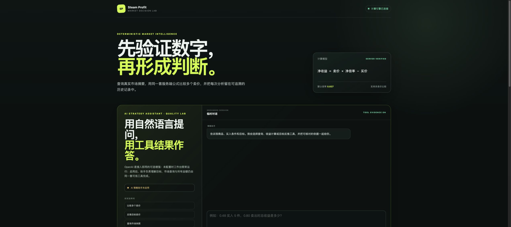
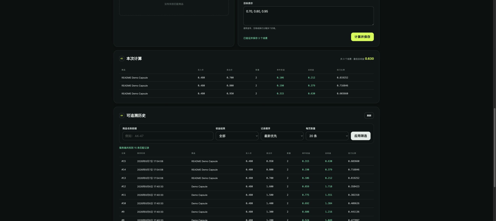
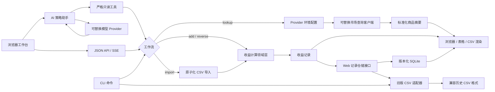

# Steam Profit Calculator：Steam 市场收益分析工作台

[](https://github.com/NoireOffical/steam-profit-calculator/actions/workflows/ci.yml)

简体中文 | [English](README.md)

Steam Profit Calculator 是一个使用 Go 编写的 Steam Community Market 收益分析应用。它同时提供带可信工具调用的 AI 策略助手、浏览器工作台和命令行工具，支持查询市场商品、按一个或多个卖价正向计算收益、根据目标收益或挂刀比例反推买卖价格、批量导入 CSV 场景，以及在服务端持久化和展示计算记录。

项目刻意保持计算公式、存储格式、外部 provider 行为和错误处理清晰可见，可作为领域建模、CLI 设计、外部 API 集成、版本化 SQLite 持久化和兼容性数据迁移的小型工程示例。

> 本项目与 Valve 或 Steam 无关联。市场数据和计算结果仅供参考，不构成投资或交易建议。

## 当前状态

最新固定里程碑是 [`v0.6.0`](docs/releases/v0.6.0.md)，已经完成确定性计算、SQLite 历史、浏览器 E2E、容器化运行和 Railway 受控演示。当前 `main` 在此基础上增加了尚未打 Tag 的 SteamApis 直接搜索适配器，具体变化记录在 [`Unreleased`](CHANGELOG.md#unreleased)。

| 范围 | 交付状态 | 默认运行状态 | 验证边界 |
| --- | --- | --- | --- |
| 收益计算、目标反推、SQLite 历史、CSV、浏览器与 CLI | **核心产品已就绪** | 无外部 Key 即可运行 | 单元/竞态测试、7 条 Chromium E2E、容器重启持久化检查 |
| Steam 官方公开市场查询 | **内置数据入口** | 默认启用 | 自动化契约测试；官方接口可能对自动请求限流 |
| SteamApis 市场查询 | **可按需扩展，适配层已就绪** | 设置 Provider 与 Key 后启用 | 认证、映射、超时、`429` 重试和失败路径已确定性验证；真实 Key smoke 可作为额外验证任务执行 |
| OpenAI 策略助手 | **可按需扩展，适配层与质量门禁已就绪** | 默认关闭，设置 Provider 与 Key 后启用 | 50 条确定性工具基线、12 条版本化语义用例和脚本 Provider 已验证；付费真实模型报告可作为额外验证任务执行 |
| Railway 受控演示 | **`v0.6.0` 已验收** | 单副本、HTTPS、共享评审凭据、SQLite Volume | 线上只读检查、平台重启持久化、导出完整性和隔离恢复均已验证 |

> SteamApis 和 OpenAI 在这里属于可插拔扩展，不是核心网站的未完成项。接入真实 Key 会增加实时市场数据或自然语言交互；不接入、暂时关闭或更换 Provider，都不影响计算、反推、历史、导入导出和 CLI。真实 Provider smoke 用于补充外部服务证据，可以单独、限量执行，不作为确定性核心的运行前置条件。

受控 Railway 演示已上线：[打开演示](https://steam-profit-calculator-production.up.railway.app)。健康检查公开，交互工作台使用单独提供的评审凭据；公开演示当前运行确定性核心，SteamApis 与 OpenAI 扩展可在提供服务端 Key 后独立启用。

## 界面预览

### 工作台与可选 AI 区域



AI 未启用时，页面会明确显示扩展状态，确定性计算工作台仍保持可用。

### 多卖价计算与 SQLite 历史



截图来自本地固定种子演示；示例记录由正式计算与持久化路径生成，不包含真实账户、API Key 或市场交易数据。

## 六个里程碑的演进

| 版本 | 可演示里程碑 |
| --- | --- |
| [`v0.1.0`](docs/releases/v0.1.0.md) | 确定性收益引擎、兼容 CLI、CSV 记录与本地浏览器基础 |
| [`v0.2.0`](docs/releases/v0.2.0.md) | 严格工具调用、依据引用和数值门禁的 AI 策略助手 |
| [`v0.3.0`](docs/releases/v0.3.0.md) | 版本化 SQLite、稳定记录 ID、筛选分页和幂等 CSV 导入 |
| [`v0.4.0`](docs/releases/v0.4.0.md) | 固定演示数据、浏览器 E2E、非 root 容器、健康与可观测性 |
| [`v0.5.0`](docs/releases/v0.5.0.md) | 类型化 OpenAI SSE、临时对话、停止/重试和版本化 AI 评测 |
| [`v0.6.0`](docs/releases/v0.6.0.md) | Railway 受控演示、访问保护、配额、持久卷、备份与恢复验证 |
| [`main`](CHANGELOG.md#unreleased) | SteamApis 轻量直接搜索和官方市场限流时的第三方 Provider 引导 |

## 外部能力：接入即用，而非运行前置条件

市场数据和 AI 都通过可替换适配器接入，不与确定性计算、SQLite 历史或 CSV 工作流绑死：

- **不配置外部 Key 也能正常使用网站。** 收益计算、目标反推、记录保存、筛选分页和导入导出始终由本地服务完成；AI 默认关闭，市场查询默认走无需 Key 的 `steam_public`。
- **SteamApis 扩展入口已就绪。** 在服务端同时设置 `STEAM_PROFIT_LOOKUP_PROVIDER=steamapis` 和 API Key 后，网页、JSON API、CLI `lookup` 与 AI 的 `lookup_items` 工具会共用同一套标准化查询入口。轮换 Key 或切回 `steam_public` 不需要修改页面、命令参数或历史数据。
- **OpenAI 扩展入口与质量门禁已就绪。** 设置 `STEAM_PROFIT_AI_PROVIDER=openai` 和服务端 API Key 即可增加自然语言助手；Provider、Base URL、模型和 Key 都由环境变量管理，可独立调整或撤销。没有模型 Key 或模型暂不可用时，只停用 AI 助手，不影响其他网站功能。
- **多入口复用同一可信内核。** 用户可以从浏览器、JSON API、CLI 或 AI 工具调用市场查询和计算能力；Provider 只负责提供外部信息，金额仍由确定性计算引擎产生。

Provider 切换是显式配置，不会暗中自动回退。启用 `steamapis` 前必须先提供有效 Key；外部数据源运行时不可用时，市场查询会清晰失败，但计算、反推和历史记录仍可继续使用。

## 核心能力

- 提供同源浏览器工作台和版本化 JSON API；
- 提供可选的 AI 策略助手，通过严格工具调用查询、计算和反推，不让模型自行计算；
- 解析 Responses API 原生类型化流，并通过 SSE 展示工具进度、结构化依据、回答和模型用量；
- 对模型回答执行数值溯源校验，无引用或工具结果中不存在的数字会被安全替换；
- 提供最多 6 条页面内临时上下文，以及显式停止和重试控制；
- 提供 50 条无需真实模型密钥的固定基线、12 条可选语义套件和 JSON 评测报告；
- Web 默认使用版本化 SQLite，记录具有稳定 ID 和 UTC 创建时间；
- 历史记录支持服务端商品/收益筛选、稳定排序和有界分页；
- 支持显式、幂等的 CSV 到 SQLite 导入，并保留 CSV 回滚模式；
- 提供七条隔离的 Playwright Chromium 流程，覆盖持久化、分页、输入错误、AI 关闭降级、临时上下文/重试、取消和演示访问控制；
- 提供非 root Docker Compose 演示、固定种子数据、SQLite 命名卷和健康检查；
- 提供可选共享演示凭据、每客户端 API 限流、全局模型调用配额和只读线上合成检查；
- 提供已验收的 Railway 单副本部署、托管 HTTPS、SQLite 持久卷、重启检查和手动导出/恢复路径；
- 每个请求具有关联 ID，并提供不记录用户内容的结构化日志与请求/助手聚合指标；
- 保留 `lookup`、`add`、`reverse`、`import`、`list` 五个独立 CLI 命令；
- 一次传入多个卖价，批量计算不同退出价格下的收益；
- 根据目标单件收益、目标总收益或挂刀比例反推买价/卖价；
- 支持数量和净倍率配置，默认净倍率为 `0.837`；
- 支持 Steam Community Market 公开搜索和 SteamApis v2 认证搜索，提供超时、限流重试和统一字段输出；
- 支持终端表格和 CSV 两种展示方式；
- 批量导入前先校验完整文件，错误输入不会造成部分落盘；
- 兼容旧版 CSV 记录格式，并在后续写入时迁移为当前格式；
- 对价格、倍率和挂刀比例执行确定性精度格式化；
- 覆盖计算、查询、导入、展示、存储和 CLI 编排层的自动测试；
- 使用 GitHub Actions 执行 Linux/macOS 确定性检查、真实浏览器 E2E 和容器重启持久化测试。

## 技术架构



## 环境要求

- Go 1.21 或更高版本；
- Node.js 与 pnpm（用于浏览器脚本检查和可选 Playwright E2E）；
- Docker Engine 或 Docker Desktop（仅容器演示需要）；
- 仅 `lookup` 命令需要网络访问。

正向计算、反向求解、导入、存储和记录读取完全在本地运行。Web 服务固定使用无需 CGo 的 `modernc.org/sqlite` 驱动；CLI 继续沿用原有 CSV 行为。

## 快速开始

在仓库根目录直接运行：

```bash
go run ./cmd/steam-profit add \
  --name "Capsule" \
  --buy 0.48 \
  --quantity 5 \
  --sell 0.70 \
  --sell 0.80
```

构建可重复使用的二进制：

```bash
make build
./.build/steam-profit list
```

运行与 CI 一致的完整本地检查：

```bash
make check
```

启动带 12 条固定记录的 3–5 分钟演示：

```bash
make demo-run
```

或者用带持久化命名卷的 Docker Compose 启动同一个单进程应用：

```bash
docker compose up --build --wait
```

完整演示顺序、浏览器测试、备份、恢复和回滚方法见[演示与运行手册](docs/DEMO_RUNBOOK.zh-CN.md)；Railway 的 HTTPS、Secret、限流、持久卷、线上检查和发布边界见[受控托管演示运行手册](docs/HOSTED_DEMO_RUNBOOK.zh-CN.md)。

受控 Railway 演示已上线：[steam-profit-calculator-production.up.railway.app](https://steam-profit-calculator-production.up.railway.app)。健康检查公开，交互工作台需要单独提供的评审凭据。托管实例已交付确定性核心；OpenAI 扩展按设计保持默认关闭，可在提供服务端 Key 和独立预算后启用或执行额外的真实模型验证。

## 浏览器工作台

启动本地 Web 应用：

```bash
make run-web
```

然后打开 `http://127.0.0.1:8080`。页面可以使用 AI 策略助手、查询商品、提交多个卖价场景、查看服务端计算结果和刷新历史记录。所有公式仍由现有 Go 领域层执行，浏览器和模型都不会复制收益公式。

服务端也可以从已构建的单一二进制启动：

```bash
make build
./.build/steam-profit-server --addr 127.0.0.1:8080 --db ./steam-profit.db
```

首个版本提供以下 API：

| 方法与路径 | 用途 |
| --- | --- |
| `GET /api/health` | 健康检查 |
| `GET /api/v1/metrics` | 读取不含用户内容的聚合运行指标 |
| `GET /api/v1/items` | 查询标准化市场商品 |
| `POST /api/v1/calculations` | 计算并保存正向收益场景 |
| `POST /api/v1/reverse-calculations` | 反推并保存目标价格 |
| `GET /api/v1/records` | 读取筛选、分页后的服务端历史记录 |
| `GET /api/v1/assistant/status` | 读取不含密钥的助手可用状态 |
| `POST /api/v1/assistant/stream` | 以 SSE 返回工具进度、依据和回答 |

`GET /api/v1/records` 支持 `item`、`outcome=all|profit|loss`、`order=newest|oldest`、`limit=1..100` 和非负 `offset`。每条记录包含稳定 `id` 与 `created_at`，响应同时给出 `total`、`limit`、`offset` 和 `has_more`。

Web 默认使用 SQLite。可以显式导入历史兼容 CSV，同一文件重复执行不会重复导入已有行：

```bash
./.build/steam-profit-server --db ./steam-profit.db --import-csv ./steam-profit-records.csv
```

导入不会修改源 CSV。若需要回退到旧版 Web 存储方式：

```bash
./.build/steam-profit-server --storage csv --file ./steam-profit-records.csv
```

| 环境变量 | 默认值 | 用途 |
| --- | --- | --- |
| `PORT` | 空 | 托管平台端口；未设置显式服务地址时监听 `0.0.0.0:$PORT` |
| `STEAM_PROFIT_STORAGE` | `sqlite` | Web 仓储：`sqlite` 或 `csv` |
| `STEAM_PROFIT_DATABASE_FILE` | `steam-profit.db` | SQLite 数据库路径 |
| `STEAM_PROFIT_RECORD_FILE` | `steam-profit-records.csv` | CSV 模式使用的记录路径 |
| `STEAM_PROFIT_IMPORT_CSV` | 空 | SQLite 启动前显式导入的兼容 CSV |
| `STEAM_PROFIT_DEMO_USERNAME` | 空 | 可选共享演示用户名；必须与密码同时配置 |
| `STEAM_PROFIT_DEMO_PASSWORD` | 空 | 可选共享演示密码；至少 12 个字符 |
| `STEAM_PROFIT_RATE_LIMIT_PER_MINUTE` | `0` | 每客户端每分钟 API 上限；`0` 表示关闭 |
| `STEAM_PROFIT_AI_RUNS_PER_HOUR` | `0` | 整个进程每小时实际模型调用上限；`0` 表示关闭 |
| `STEAM_PROFIT_TRUST_PROXY_HEADERS` | `false` | 仅在受信代理提供 `X-Real-IP` 或 `X-Forwarded-For` 时启用 |

每个 HTTP 响应都包含 `X-Request-ID`。请求日志只记录方法、路径、状态、耗时和关联 ID；聚合指标不记录查询字符串、请求体、Prompt、模型回答、市场数据、密钥或历史记录值。

当前 Web 版本定位为本地单用户应用或少量评审使用的受控演示。Railway 实例已经验收共享 Basic 凭据、公开依赖健康检查、请求限流、单个 SQLite 持久卷、应用重启，以及通过 SQLite 完整性与隔离启动检查的全卷导出。若扩展为公开多租户产品，还需要注册、租户隔离、跨实例限流、持久化监控和托管备份/PITR；这些属于后续运营范围。付费真实模型基线属于可选的 OpenAI 扩展验证证据，不是确定性网站能力缺口。浏览器最多发送 6 条页面内历史，但对话、Provider 响应和工具依据都不落盘。

## AI 策略助手

助手是“接入即用”的可选增强，默认关闭；没有模型密钥时，服务器、浏览器确定性工作台和 CLI 都可以正常运行。要启用 OpenAI Provider：

```bash
export STEAM_PROFIT_AI_PROVIDER=openai
export STEAM_PROFIT_AI_API_KEY="your-api-key"
make run-web
```

也可以使用标准的 `OPENAI_API_KEY`。密钥、模型、Base URL 和 Provider 配置都从环境读取，后续可以随时替换或关闭；切换不迁移计算记录，也不改变确定性工具契约。不要把真实密钥写进 `.env.example` 或提交到 Git。

| 环境变量 | 默认值 | 用途 |
| --- | --- | --- |
| `STEAM_PROFIT_AI_PROVIDER` | `disabled` | `disabled` 或 `openai` |
| `STEAM_PROFIT_AI_BASE_URL` | `https://api.openai.com/v1` | Responses API 基础地址 |
| `STEAM_PROFIT_AI_MODEL` | `gpt-5.6-terra` | 可替换模型名称 |
| `STEAM_PROFIT_AI_REASONING_EFFORT` | `low` | `none` / `low` / `medium` / `high` / `xhigh` / `max` |
| `STEAM_PROFIT_AI_VERBOSITY` | `low` | `low` / `medium` / `high` |
| `STEAM_PROFIT_AI_MAX_OUTPUT_TOKENS` | `1200` | 单次模型回答的最大输出 Token |
| `STEAM_PROFIT_AI_TIMEOUT_MS` | `25000` | 单次模型请求超时 |
| `STEAM_PROFIT_AI_API_KEY` | 空 | OpenAI API 密钥，优先于 `OPENAI_API_KEY` |

实现遵循 OpenAI 官方的 [Responses API 函数调用](https://developers.openai.com/api/docs/guides/function-calling)和[类型化流式响应](https://developers.openai.com/api/docs/guides/streaming-responses)流程；三个工具是只读的：

- `lookup_items`：读取带查询时间的市场快照；
- `calculate_profit`：调用确定性正向计算，不保存记录；
- `solve_target`：调用确定性反推，不保存记录。

每个成功工具结果都会生成 `T1`、`T2` 形式的依据编号。最终模型文本必须引用当前轮相关编号，且其中每个数字都必须存在于当前轮工具输出，否则服务端会用安全说明替换模型原文。SSE 事件仍为 `status`、`tool_start`、`evidence`、`delta`、`done` 和 `error`。Provider 原生文本及函数参数增量会先在服务端聚合；完整回答通过数值溯源后，才按 Provider 原始增量边界发送给浏览器，未通过的原文不会短暂暴露。可选 `history` 字段最多接受 6 条 `user` 或 `assistant` 消息且只存在于当前页面。

### AI 质量评测

普通测试会离线执行 50 条确定性工具用例和脚本化报告测试，不访问 Steam 或 OpenAI。真实模型语义评测是一项可选扩展验证任务，不影响核心网站启动或确定性质量门禁；需要时可显式启用，并使用固定查询夹具：

```bash
export STEAM_PROFIT_AI_PROVIDER=openai
export STEAM_PROFIT_AI_API_KEY="temporary-key"
make ai-eval
make ai-eval-baseline
```

当前 Prompt 报告写入 `.build/evaluations/report.json`，保留的基线 Prompt 写入 `.build/evaluations/baseline-report.json`。报告包含用例 ID、Prompt/模型版本、实际工具、溯源结果、延迟、Token、阈值失败和可选成本估算，不包含密钥、Prompt 文本、模型原文或工具值。只有调用者显式传入 `--input-usd-per-million` 与 `--output-usd-per-million` 等费率时才估算成本，仓库不内置易过期的价格表。

GitHub 的 `Live AI Evaluation` 工作流只能手动触发，使用仓库 Secret 执行有界的当前/基线对比并保留脱敏报告；普通 CI 不调用真实模型。配置线上地址后，`Hosted Demo Smoke` 每 6 小时执行一次不写数据、不调用模型的只读检查。配置方法见[受控托管演示运行手册](docs/HOSTED_DEMO_RUNBOOK.zh-CN.md)。

## 命令总览

| 命令 | 用途 | 写入记录 |
| --- | --- | --- |
| `lookup` | 查询商品标识和实时市场摘要字段 | 否 |
| `add` | 正向计算一个或多个卖价场景 | 是 |
| `reverse` | 根据单一目标指标反推买价或卖价 | 是 |
| `import` | 原子化校验并导入 CSV 批量场景 | 是 |
| `list` | 展示已经保存的记录 | 否 |

### 查询市场商品

```bash
go run ./cmd/steam-profit lookup \
  --query "AK-47" \
  --limit 5
```

默认 provider 仍为 Steam Community Market 的公开搜索接口，默认应用 ID 为 `730`。也可以选择 `steamapis`，直接使用 SteamApis v2 关键词搜索；该最小路径不会下载全量目录，也不会追加详情请求。查询结果是只读快照，不会写入收益记录文件。

### 正向计算收益

```bash
go run ./cmd/steam-profit add \
  --name "Capsule" \
  --buy 0.48 \
  --quantity 5 \
  --multiplier 0.85 \
  --sell 0.70 \
  --sell 0.80
```

重复传入 `--sell` 可以计算多个卖价。每条结果都会展示并追加到指定记录文件。

### 根据目标反推

根据目标总收益反推卖价：

```bash
go run ./cmd/steam-profit reverse \
  --name "Capsule" \
  --solve sell \
  --buy 0.48 \
  --quantity 5 \
  --target-total-profit 1.00
```

根据目标挂刀比例反推买价：

```bash
go run ./cmd/steam-profit reverse \
  --name "Capsule" \
  --solve buy \
  --sell 0.80 \
  --target-knife-ratio 0.70
```

`--target-net-profit`、`--target-total-profit` 和 `--target-knife-ratio` 必须且只能提供一个。

### 批量导入

输入文件必须使用以下表头：

```csv
item_name,buy_price,sell_price,quantity,multiplier
Capsule,0.48,0.70,5,
Capsule,0.48,0.80,5,0.85
```

导入并使用 CSV 风格输出：

```bash
go run ./cmd/steam-profit import --input ./inputs.csv --output csv
```

程序会先校验完整文件，再统一写入结果；任意一行非法都不会产生部分记录。

### 查看历史记录

```bash
go run ./cmd/steam-profit list
go run ./cmd/steam-profit list --output csv --file ./custom-records.csv
```

默认记录文件为 `steam-profit-records.csv`。该文件属于本地运行数据，已加入 Git 忽略规则。

## 计算模型

设买价为 `B`、卖价为 `S`、数量为 `Q`、净倍率为 `M`：

```text
单件收益 = S × M - B
总收益   = 单件收益 × Q
挂刀比例 = B / (S × M)
```

默认值：

- 数量：`1`
- 净倍率：`0.837`

价格按三位小数存储，挂刀比例按六位小数存储，显式传入的倍率按三位小数记录。

## 查询配置

`lookup` 可以通过环境变量调整 provider 行为：

同一套标准化查询边界同时服务于网页搜索、`/api/v1/items`、CLI `lookup` 和 AI 的只读 `lookup_items` 工具。切换 Provider 或轮换 Key 不改变这些入口，也不会迁移或改写收益历史；数据源暂不可用时，仅市场查询受影响。

| 环境变量 | 默认值 | 用途 |
| --- | --- | --- |
| `STEAM_PROFIT_LOOKUP_PROVIDER` | `steam_public` | 查询实现：`steam_public` 或 `steamapis` |
| `STEAM_PROFIT_LOOKUP_BASE_URL` | 跟随 Provider | Provider 地址；`steam_public` 为 `https://steamcommunity.com`，`steamapis` 为 `https://marketplaceapi.steamapis.com` |
| `STEAM_PROFIT_LOOKUP_APP_ID` | `730` | Steam 应用 ID |
| `STEAM_PROFIT_LOOKUP_TIMEOUT_MS` | `5000` | 请求超时 |
| `STEAM_PROFIT_LOOKUP_API_KEY` | 空 | `steamapis` 必需的服务端 API Key |
| `STEAM_PROFIT_LOOKUP_API_KEY_HEADER` | `X-API-Key` | API Key 请求头 |
| `STEAM_PROFIT_LOOKUP_USER_AGENT` | `steam-profit-calculator/lookup` | HTTP User-Agent |

密钥应通过环境变量注入。本地 `.env` 文件已被忽略，不应提交到仓库。

使用 SteamApis 直接搜索：

```bash
export STEAM_PROFIT_LOOKUP_PROVIDER=steamapis
export STEAM_PROFIT_LOOKUP_API_KEY="your-steamapis-key"
go run ./cmd/steam-profit lookup --query "AK-47 Redline" --limit 5
```

SteamApis 搜索结果可能来自 Buff163、Skinport 等第三方 marketplace。当前兼容输出会把来源附在 `sell_price_text` 中，例如 `$45.99 (Buff163)`；`sale_price_text` 留空，因为轻量搜索接口不返回独立的最近成交价。该报价是 Provider 快照，不是 Steam 官方报价。

SteamApis 的适配器、配置校验和失败路径均已实现。提供临时 Key 后执行一次限量真实查询属于额外的环境验证任务，用来确认当时的第三方服务、套餐和凭据状态；它不改变核心网站的完成状态，也不会把外部 Provider 变成计算或存储的依赖。

## 记录格式

终端表格和 `--output csv` 使用七个字段：

```text
item_name,buy_price,sell_price,quantity,net_profit,total_profit,knife_ratio
```

落盘记录会增加 `fee` 字段，用于记录本次计算采用默认倍率还是显式倍率：

```text
item_name,buy_price,sell_price,quantity,net_profit,total_profit,knife_ratio,fee
```

旧版五列和七列文件仍可读取，并会在后续追加记录时迁移到当前格式。

Web SQLite 使用缩放整数保存同一组规范化数值，并增加记录 ID、UTC 创建时间、来源信息以及可空的未来归属/会话字段。`schema_migrations` 记录有序迁移；已经发布的迁移不会修改。

## 项目结构

```text
cmd/steam-profit/        CLI 入口
cmd/steam-profit-server/ Web 服务入口
cmd/steam-profit-eval/   可选真实模型语义评测入口
internal/calculation/    正向计算与反向求解
internal/cli/            参数解析与工作流编排
internal/display/        表格和 CSV 输出
internal/domain/         请求、记录与字段模型
internal/importer/       原子化批量导入
internal/lookup/         Provider 配置与 HTTP 客户端
internal/assistant/      模型 Provider、只读工具、数值溯源和评测
internal/evaluation/     版本化语义套件与不含用户内容的报告
internal/observability/ 请求关联、安全日志与聚合指标
internal/storage/        SQLite 仓储、CSV 兼容与迁移
internal/webapi/         JSON API 与嵌入式浏览器应用
demo/                    确定性幂等种子数据
tests/e2e/               Playwright 浏览器工作流
openspec/                需求规范与历史变更
```

## 开发与质量检查

```bash
make fmt
make vet
make test-race
make build
make run-web
make e2e
make container-check
```

`main` 已启用分支保护：变更通过 Pull Request 合入，必须保持分支最新、解决评审对话，并通过 5 项必需检查（三组 Go 平台检查、Chromium E2E 和 Compose 持久化冒烟）；禁止强推和删除分支。Dependabot 每周检查 Go 模块、JavaScript 包、容器基础镜像和 GitHub Actions。

完整命令参数、字段说明和错误示例见 [CLI_USAGE.md](CLI_USAGE.md)。

AI、数据库、评测与公开运营的进一步扩展方向见 [AI 全栈实践路线与工作量评估](docs/AI_FULLSTACK_ROADMAP.zh-CN.md)。

每个可演示里程碑都使用不可移动的语义化版本 Tag 和 GitHub Pre-release，规则见 [里程碑发布流程](docs/development/release-workflow.md)，版本记录见 [CHANGELOG](CHANGELOG.md)。

## 许可证

项目采用 [MIT License](LICENSE)。
